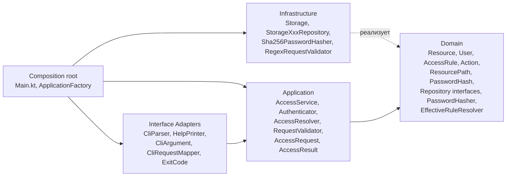

# Чистая архитектура проекта

## Чистая архитектура: кратко

Организация кода, при которой:

1. Бизнес-логика не зависит от инфраструктуры. Домен не знает о БД, CLI, HTTP, фреймворках.
2. Зависимости направлены внутрь. Внешние слои знают о внутренних, не наоборот.
3. Границы пересекаются через абстракции. Внутренний слой объявляет интерфейс, внешний — реализует.
4. Домен тестируется без запуска приложения: ни БД, ни CLI не нужны.

```
┌─────────────────────────────────────────────────────┐
│  Infrastructure (Frameworks & Drivers)              │
│  ┌───────────────────────────────────────────────┐  │
│  │  Interface Adapters                           │  │
│  │  ┌─────────────────────────────────────────┐  │  │
│  │  │  Application (Use Cases)                │  │  │
│  │  │  ┌───────────────────────────────────┐  │  │  │
│  │  │  │  Domain (Entities)                │  │  │  │
│  │  │  └───────────────────────────────────┘  │  │  │
│  │  └─────────────────────────────────────────┘  │  │
│  └───────────────────────────────────────────────┘  │
└─────────────────────────────────────────────────────┘
         ↑ зависимости направлены внутрь ↑
```

## 1. Слои в проекте

Выделяются четыре слоя плюс composition root.

### 1.1. Domain — ядро

Модели и правила, ни от чего не зависящие. Никаких импортов из `java.security`, `java.io`, CLI.

| Класс | Текущий файл | Пояснение |
|---|---|---|
| `Resource` | `Models.kt` | Доменная сущность ресурса |
| `AccessRule` | `Models.kt` | Доменное правило доступа |
| `User` | `Models.kt` | Доменная сущность пользователя |
| `Action` | `Models.kt` | Перечисление действий |
| `ResourcePath` *(новый)* | — | Value-класс для пути |
| `PasswordHash` *(новый)* | — | Value-класс для хеша |
| `UserRepository` | `AccessService.kt` | Интерфейс репозитория |
| `ResourceRepository` | `AccessService.kt` | Интерфейс репозитория |
| `RuleRepository` | `AccessService.kt` | Интерфейс репозитория |
| `PasswordHasher` *(новый)* | — | Интерфейс хеширования |
| `EffectiveRuleResolver` *(новый)* | — | Наследование прав по пути |

Интерфейсы репозиториев — часть контракта домена. Реализации живут в инфраструктуре, абстракции принадлежат ядру (DIP).

`AccessRequest` в домен **не входит** — это DTO приложения (см. 1.2).

### 1.2. Application — сценарии

Оркестрация доменных объектов. Не знает о CLI, БД и конкретных реализациях.

| Класс | Текущий файл | Пояснение |
|---|---|---|
| `AccessRequest` *(DTO)* | `Models.kt` | Входные данные use case |
| `AccessResult` *(новый)* | — | Результат use case: `Success`, `BadLogin`, `NoAccess`, … |
| `AccessService` | `AccessService.kt` | Тонкий оркестратор после рефакторинга |
| `CheckAccessUseCase` *(новый)* | — | Явный use case проверки доступа |
| `Authenticator` *(новый)* | — | Аутентификация пользователя |
| `AccessResolver` *(новый)* | — | Применение правила к запросу |
| `RequestValidator` *(новый)* | — | Интерфейс валидации запроса |

Почему `Authenticator` и `AccessResolver` здесь, а не в домене. Домен отвечает на вопрос «что такое правило доступа» и «наследуется ли право по пути». Application отвечает на «взять пользователя, найти правило, применить, вернуть результат». Это разные уровни.

### 1.3. Interface Adapters — адаптеры

Преобразование данных между внешним миром и application. CLI-парсинг, маппинг DTO, форматирование ответа, коды возврата процесса.

| Класс / функция | Текущий файл | Пояснение |
|---|---|---|
| `parseKeyValues` | `Cli.kt` | Парсинг аргументов CLI |
| `printHelp` | `Cli.kt` | Вывод справки |
| `CliArgument` *(новый)* | — | Enum CLI-ключей |
| `CliRequestMapper` *(новый)* | — | `Map<String,String>` → `AccessRequest` |
| `ExitCode` *(новый)* | — | Маппинг `AccessResult` → код возврата CLI |

CLI — адаптер входа, как веб-контроллер или gRPC-сервер. Работает с доменом через use case'ы. Инфраструктура — это «железо»: БД, сеть, файлы.

### 1.4. Infrastructure — инфраструктура

Конкретные реализации абстракций домена. Самая внешняя оболочка.

| Класс / функция | Текущий файл | Пояснение |
|---|---|---|
| `Storage` (object) | `Storage.kt` | Захардкоженные данные |
| `StorageUserRepository` | `AccessService.kt` | Реализация `UserRepository` |
| `StorageResourceRepository` | `AccessService.kt` | Реализация `ResourceRepository` |
| `StorageRuleRepository` | `AccessService.kt` | Реализация `RuleRepository` |
| `hashPassword` | `Storage.kt` | Криптография |
| `hexToBytes` | `Storage.kt` | Утилита |
| `InMemoryUserStorage` *(новый)* | — | Хранилище пользователей |
| `InMemoryResourceStorage` *(новый)* | — | Хранилище ресурсов |
| `InMemoryRuleStorage` *(новый)* | — | Хранилище правил |
| `Sha256PasswordHasher` *(новый)* | — | Реализация `PasswordHasher` |
| `RegexRequestValidator` *(новый)* | — | Реализация `RequestValidator` |

### 1.5. Composition root

`Main.kt` и `ApplicationFactory` — не слой. Это единственное место, где разрешено знать обо всех слоях. Собирают граф зависимостей, парсят CLI, вызывают use case, маппят результат в код возврата.

### 1.6. Сводная схема



Сплошные стрелки — зависимости. Пунктирная — реализация интерфейсов.
