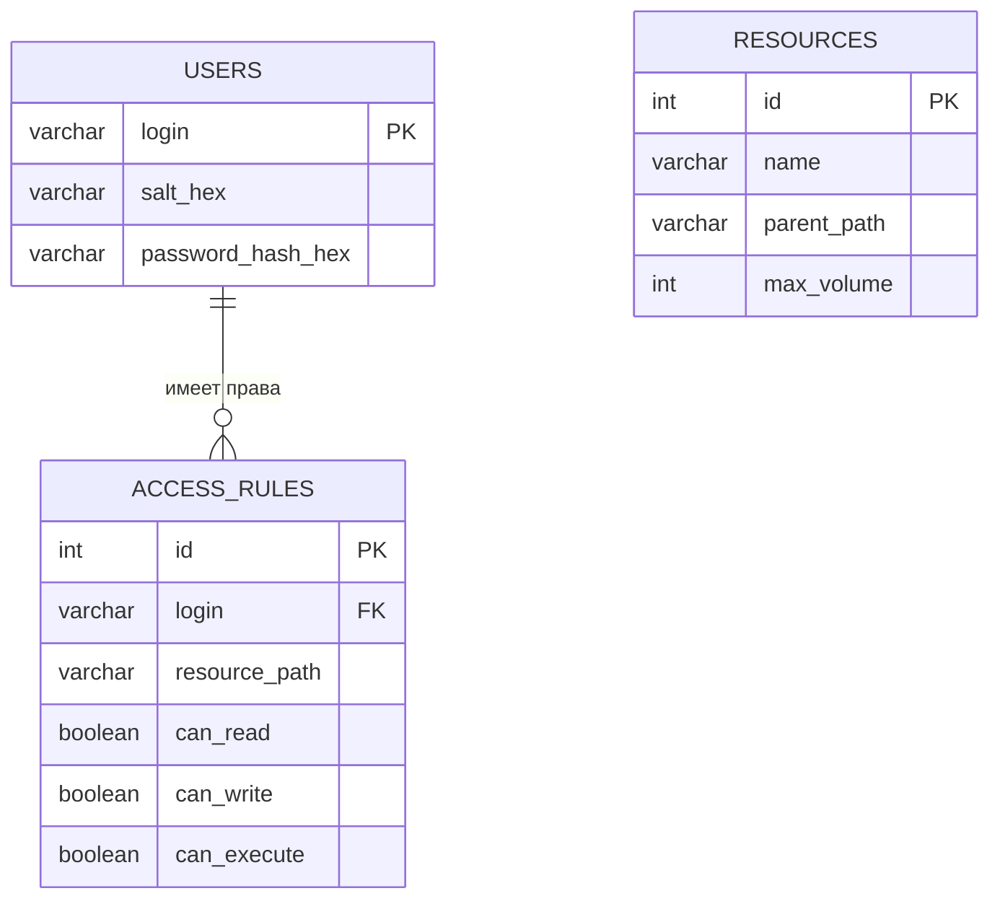

# План базы данных

## 1. Сущности и их атрибуты

В проекте выделяются три основные сущности, которые ранее хранились в виде `List` в коде (в объекте `Storage`). Теперь они будут храниться в реляционной базе данных H2.

### 1.1. Пользователь (`users`)

Хранит данные для аутентификации.

* `login` (VARCHAR, PRIMARY KEY) — уникальный логин пользователя.
* `salt_hex` (VARCHAR) — соль для хеширования пароля (в hex-формате).
* `password_hash_hex` (VARCHAR) — хеш пароля (в hex-формате).

### 1.2. Ресурс (`resources`)

Хранит информацию о доступных объектах (файлах/папках).

* `id` (INT, PRIMARY KEY, AUTO_INCREMENT) — суррогатный первичный ключ.
* `name` (VARCHAR) — имя ресурса (например, "A", "B", "C").
* `parent_path` (VARCHAR) — путь до родительской папки (может быть пустым).
* `max_volume` (INT) — максимально допустимый объем.

### 1.3. Правило доступа (`access_rules`)

Определяет права конкретного пользователя на конкретный ресурс.

* `id` (INT, PRIMARY KEY, AUTO_INCREMENT) — суррогатный первичный ключ.
* `login` (VARCHAR, FOREIGN KEY → users.login) — кому принадлежит правило.
* `resource_path` (VARCHAR) — путь до ресурса, к которому применяется правило.
* `can_read` (BOOLEAN) — разрешено ли чтение.
* `can_write` (BOOLEAN) — разрешена ли запись.
* `can_execute` (BOOLEAN) — разрешено ли выполнение.

## 2. Связи между сущностями

* **Пользователи и правила**: связь «один ко многим» (`1:N`). Один пользователь может иметь несколько правил доступа. Реализуется через внешний ключ `login` в таблице `access_rules`.
* **Ресурсы и правила**: прямого внешнего ключа нет, так как правило ссылается на строковый путь (`resource_path`), а не на ID ресурса. Это связано с иерархической природой ресурсов (правило может быть задано для родительской папки, а применяться к дочерним). Связь логическая.

## 3. ER-диаграмма (Mermaid)



## 4. Техническая сторона вопроса

### 4.1. Драйвер и СУБД

* **СУБД**: H2 Database (встроенный файловый режим).
* **Драйвер**: `h2-x.x.x.jar` (будет добавлен в папку `lib/`).
* **URL подключения**: `jdbc:h2:./data/app_db` (база данных будет храниться в файле `app_db.mv.db` в папке `data`).

### 4.2. Механизм заполнения базы

Для инициализации базы данных будут использоваться SQL-скрипты:

* `scripts/sql/init.sql` — создание таблиц (`CREATE TABLE`).
* `scripts/sql/fill.sql` — наполнение таблиц тестовыми данными (`INSERT`).

Для применения скриптов будет создан bash-скрипт `scripts/init-db.sh`, который вызовет утилиту `RunScript` из пакета H2:

```bash
java -cp lib/h2-*.jar org.h2.tools.RunScript -url jdbc:h2:./data/app_db -script scripts/sql/init.sql -user sa -password ""
java -cp lib/h2-*.jar org.h2.tools.RunScript -url jdbc:h2:./data/app_db -script scripts/sql/fill.sql -user sa -password ""
```

## 5. Планируемые изменения в программном коде

Благодаря чистой архитектуре, бизнес-логика (`AccessService`) не будет изменена. Нам нужно только добавить новые реализации интерфейсов.

### 5.1. Новые компоненты (в пакете `infrastructure.repository.jdbc`)

1. **`DatabaseConnection`** — утилитный класс для управления подключением к H2. Будет отвечать за загрузку драйвера и выдачу `Connection`.
2. **`JdbcUserRepository`** — реализация `UserRepository`. Выполняет SQL-запросы `SELECT login, salt_hex, password_hash_hex FROM users WHERE login = ?`. Также содержит логику проверки пароля (сравнение хешей).
3. **`JdbcResourceRepository`** — реализация `ResourceRepository`. Выполняет запросы `SELECT * FROM resources WHERE name = ?`.
4. **`JdbcRuleRepository`** — реализация `RuleRepository`. Выполняет запрос `SELECT * FROM access_rules WHERE login = ? AND resource_path = ?` (с учётом иерархии правил).

### 5.2. Обработка ошибок (новые коды возврата)

* В `Main.kt` (или в `AccessService`) добавится перехват исключений:
  * `SQLException` при подключении — выход с кодом **9**.
  * `SQLException` при выполнении запроса — выход с кодом **10**.

### 5.3. Изменения в `ApplicationFactory`

Фабрика переключится с `StorageUserRepository` (in-memory) на `JdbcUserRepository` (база данных). Старые in-memory репозитории останутся в проекте для тестов (лаба №5) и не будут удалены.
